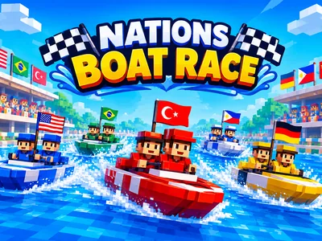
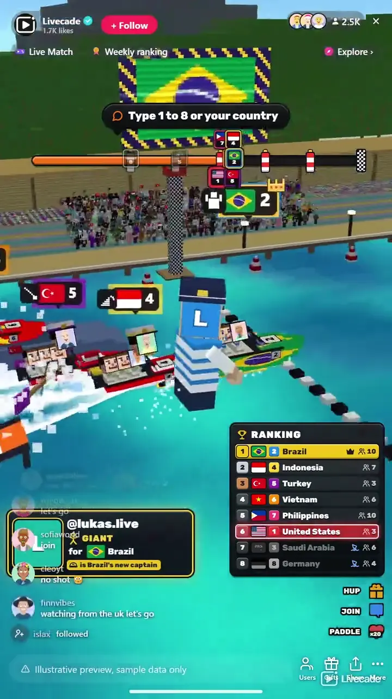

# Nations Boat Race - Interactive TikTok Live Game

> Your chat picks a country, rides its boat and keeps it afloat.

Countries race blocky speedboats in 3D on your stream. Viewers join a country once, every gift boosts its boat, the top gifters ride as its crew, and the last boat at each knockout buoy sinks.

**[Play Nations Boat Race on Livecade](https://livecade.io/games/nations-boat-race/?utm_source=github&utm_medium=readme&utm_campaign=nations-boat-race)** - runs as a single browser source in OBS, Streamlabs, or TikTok LIVE Studio. Nothing for viewers to install.

## How viewers play

Viewers take part with the actions TikTok already gives them: **comments**, **gifts**, **likes**, **follows**. Every action below is rebindable, so you decide which interaction drives which effect.

| Action | What it does |
| --- | --- |
| **Join a team** | Puts the viewer on the country they type: a lane number or the country's name. Any comment that names one does it by default |
| **Paddle** | The crew lean over and paddle with their hands for a little extra pace. 20 likes by default |
| **Hup** | One giant oar stroke with a shout of HUP, one stroke per send. A Rose by default |
| **Ramp** | A ramp pops up out of the water and the boat flies off it, three seconds at speed. A Finger Heart or a follow by default |
| **Whale** | A whale surfaces under the boat and carries it on its back for five seconds at double pace. A Hand Heart by default |
| **Giant** | The captain grows into a giant and pushes the boat through the water for five seconds, the fastest run in the game. A Money Gun by default |

## How it works

### Pick a country once

A viewer types a lane number or a country's name and joins that country. Every gift and like they send afterwards boosts its boat, and a gift from a viewer with no country puts them on the one in last place still afloat.

### Gifters ride as crew

The country's biggest gifters in the race sit in the boat with their profile pictures as faces, the biggest at the wheel as captain. The seats open again every race.

### Knockout buoys

At each knockout buoy the last boat sinks, until three finalists race for the podium. The boat in danger flashes and a siren sounds, and a sunk country's gifts wait for the next race.

### Boosts only help

Paddle, oar stroke, ramp jump, whale ride and giant captain, each faster and longer than the last. Every send is its own stroke or splash on screen, and no gift slows another country.

## About the game

Nations Boat Race turns your TikTok Live into a speedboat race between countries. Up to ten boats painted in their countries' flags line up on the water in front of the grandstand, and after 3, 2, 1 they race round a buoy course to the finish line. Viewers pick a side once, by typing the lane number or the country's name, and from then on everything they send powers that boat.

### Your top gifters ride the boat

Each boat carries a captain and three crew, and the seats go to the country's biggest gifters in that race, their profile pictures as the sailors' faces. The biggest one stands at the wheel in a captain's hat. A bigger gift takes the wheel, the old captain moves back a seat, and the seats open again at the start of every race, so the first gifter of a race claims the wheel.

### Knockout buoys

Big yellow knockout buoys stand along the course, one for each boat over three. When every other boat has passed one, the boat still behind it sinks on the spot, its crew bobbing in lifebuoys, until three finalists race for the podium. The boat in danger flashes on the ranking and a siren sounds, so its country knows it needs help. Gifts sent to a sunk country are saved for the next race.

### A ladder of boosts

Out of the box 20 likes make the crew paddle with their hands, a Rose is one giant oar stroke with a shout of HUP, a Finger Heart or a follow launches the boat off a ramp, a Hand Heart sends a whale up under it to carry it on its back, and a Money Gun turns the captain into a giant who wades through the water pushing the boat. Any other gift plays the boost for its price, so the same coins buy the same distance. Every boost only helps the sender's own boat, and a gentle catch-up keeps races close without slowing the leader.

### Four maps and your own teams

Race in the Harbor, a Tropical Lagoon, an Ice Fjord in falling snow or a Night Canal under the city lights, or a new map every race (the default). Pick 2 to 10 countries in any order, race colors when everyone is from one country, or set up your own teams with their names, colors and pictures. The three finalists stand on the podium on the pier, the winning captain's face biggest of all.

## What it looks like on stream

[Watch Nations Boat Race gameplay](https://cdn.livecade.io/games/nations-boat-race.mp4)

## What you can configure

- **Language** - Thirteen languages for everything on screen, country and color names included
- **Teams** - Countries, colors, or your own teams with their names, colors and pictures, 2 to 10 lanes
- **Map** - Harbor, Tropical Lagoon, Ice Fjord or Night Canal, or a new map every race (the default)
- **Race length** - Short, medium or long: about 1, 2 or 3 minutes without boosts. Boosts make a race with gifts end sooner
- **Knockouts** - On (the default) or off: the last boat at each knockout buoy sinks until three are left
- **Catch-up** - Off, gentle (the default) or strong: how much longer the boosts of a boat behind the leader run
- **Camera shows big boosts** - The camera flies to a Whale or a Giant and holds on it for about 6 seconds. A sinking boat always gets the camera
- **Colors** - The accent, highlight and panel colors of everything on screen

## Languages

English, Spanish, Portuguese, French, German, Italian, Indonesian, Arabic, Turkish, Russian, Hindi, Romanian, Filipino

## FAQ

<strong>How do viewers join a country in Nations Boat Race?</strong>

They comment the lane number or the country's name, in any of the thirteen languages, or its flag emoji. They join once, and from then on everything they send goes to that country. A viewer who sends a gift before joining is put on the country in last place still afloat, so no gift is lost.

<strong>What do gifts do?</strong>

Out of the box 20 likes make the crew paddle, a Rose is an oar stroke, a Finger Heart or a follow is a ramp jump, a Hand Heart a whale ride and a Money Gun a giant captain. Any other gift plays the boost for its price. Every action can be rebound to any gift, or to comments, likes and follows.

<strong>How do viewers get on the boat?</strong>

By gifting. The country's four biggest gifters in the race ride as its crew with their profile pictures as faces, and the biggest stands at the wheel as captain. The seats open again at the start of each race.

<strong>What happens when a boat sinks?</strong>

It is out of that race, and its crew bob in lifebuoys. Gifts sent to its country afterwards are saved and go off at the start of the next race, and its viewers can switch to another country.

<strong>Will Nations Boat Race run on my PC?</strong>

It renders in 3D on the computer running your stream, so give it a reasonably modern machine. Try it in the dashboard preview before you go live.

<strong>How do I add Nations Boat Race to my TikTok Live?</strong>

Add one browser source URL to OBS or TikTok LIVE Studio and go live. The game is a 9:16 vertical overlay, and there is no plugin or app to install.

## Setup

1. [Create a Livecade account](https://app.livecade.io/register?utm_source=github&utm_medium=cta&utm_campaign=nations-boat-race)
2. Copy your overlay browser source URL
3. Paste it into OBS, Streamlabs, or TikTok LIVE Studio
4. Pick Nations Boat Race, set your triggers, and go live

Runs in the browser, so it works on Windows and macOS with nothing to download. [See all TikTok Live games](https://livecade.io/tiktok-live-games/?utm_source=github&utm_medium=readme&utm_campaign=nations-boat-race).

---

_This repository documents Nations Boat Race, a hosted interactive game by [Livecade](https://livecade.io/?utm_source=github&utm_medium=footer&utm_campaign=nations-boat-race). The game runs on Livecade's platform, so there is no source to install here._
